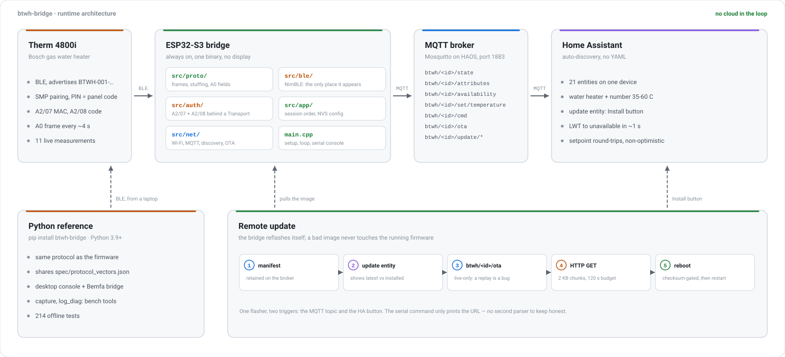

# btwh-bridge

**English** | [简体中文](README.zh-CN.md)

> **Unofficial project.** A BLE interoperability implementation for the Bosch
> **Therm 4800i** gas water heater — a Python reference implementation plus an
> always-on ESP32 gateway, targeting **Home Assistant** as the primary integration.
>
> Verified on real hardware: **Bosch Therm 4800i**, whose BLE module advertises
> itself as `BTWH-001-xxxx` (the identifier the code actually matches on).
>
> Not affiliated with, authorised by, or endorsed by Robert Bosch GmbH or its
> affiliates in any way.

<picture>
  <source media="(prefers-color-scheme: dark)" srcset="docs/diagrams/architecture-dark.svg">
  
</picture>

*Solid arrows are the live path. Dashed arrows are the bench and update paths: a laptop can talk
to the heater directly, and the bridge can reflash itself without a USB cable.*

## Why this exists

The official **Bosch Water** app talks to one phone at a time over Bluetooth, and
that is the whole story: no local API, no Home Assistant, no automation, no history
beyond the last five showers. A water heater that cannot join the rest of your home
is a standalone appliance with a touchscreen.

For owners in mainland China it is worse: Bosch has left that market and the app is
no longer downloadable there, leaving installed units permanently app-less. This
project began as a way to keep one of those heaters usable, and turned into a full
reverse-engineering of the heater's private **PowerBus BLE** protocol.

The result turns the heater into a **programmable local device**: read temperatures,
watch combustion state, set a target temperature — and it shows up in Home Assistant
as first-class sensor and number entities, with no cloud anywhere in the loop.

**Every protocol finding is captured as testable code.** A Python reference
implementation, cross-platform golden vectors, and an ESP32 C++ implementation are
all pinned to the same set of hex vectors, so the two implementations cannot drift
apart silently.

---

## Status

| Component | State | Notes |
|---|---|---|
| Python library `bosch_api` | ✅ Ready | **204** offline tests green; signature-freeze contract + golden vectors |
| Desktop console / Mi Home bridge | ✅ Ready | tkinter GUI + Bemfa cloud (China region, optional) |
| ESP32-S3 gateway firmware v2 | ✅ Verified | Real-device link-up: SMP encryption → `A2/07` → `A2/08=01` → steady `A0` stream; auto-recovers after power cycle, including "board boots before the AP" |
| MQTT / Home Assistant auto-discovery | ✅ Verified end-to-end | 21 entities auto-discovered (water heater + 11 measurements + 8 diagnostics + 1 firmware-update, incl. RSSI and last-disconnect for remote troubleshooting); setpoint commands round-trip verified against a production Mosquitto on HAOS; see [MQTT.md](docs/MQTT.md) |
| OTA firmware updates | ✅ Verified end-to-end | The bridge reflashes itself over its own MQTT link (HTTP image, checksum-gated; a failed image never touches the running firmware). The Home Assistant update entity's Install button drives the same path; see [CHANGELOG](CHANGELOG.md) |
| Wi-Fi provisioning (Improv) | 📐 Spec done | Defined by `python/device_fsm.py` + [API.md §9](docs/API.md) |

---

## Who this is for

Three layers, and they are cumulative — layer 3 is built on layer 1's findings, and layer 2 is
how you debug layer 3 without a soldering iron.

| Layer | If you want | Take | Requires |
|---|---|---|---|
| **1** | The protocol, documented | [`docs/BLE_PROTOCOL.md`](docs/BLE_PROTOCOL.md) + [`spec/protocol_vectors.json`](spec/protocol_vectors.json) | nothing — reimplement in Rust, Go or JS and check yourself against the vectors |
| **2** | A working client today | [`python/`](python/) — `pip install btwh-bridge`, `import bosch_api` | Python 3.9+ and Bluetooth: laptop, Raspberry Pi, NAS |
| **3** | A device that just works | [`firmware/bridge/`](firmware/bridge/) — flash once | An ESP32-S3 board; the pairing code is entered once, then it survives power loss |

**Layer 1 is not "just documentation".** Every field offset in the protocol notes has a matching
byte string in `spec/protocol_vectors.json`, so an implementation in another language can prove
itself correct rather than guess. That is also what keeps the Python and C++ versions honest with
each other.

**Layer 2 also ships the debugging tools** — the desktop console, the frame capture, the log
analyser. Layer 3 was built with them, and you will want them the first time something misbehaves.

**Layer 3 is the target state**: the heater shows up in Home Assistant, and afterwards no laptop
is involved at all.

---

### Python client vs. ESP32 gateway

| | Python client | ESP32 gateway |
|---|---|---|
| Hardware | Laptop / Raspberry Pi / NAS | Waveshare ESP32-S3-DEV-KIT-N8R8 or similar |
| Good for | Experiments, capture, ad-hoc control | 24/7 operation, feeding HA / Mi Home |
| Pairing code | Re-enter each start | Flash once, enter at runtime, persisted in NVS |
| Reconnect | In-process auto-reconnect | Firmware auto-reconnect + power-cycle recovery |
| State | ✅ Ready | ✅ Verified |

---

## Features

| Feature | Detail |
|---|---|
| Live temperatures | Outlet / inlet / heat exchanger / chassis, 0.1 °C resolution, refreshed every 4–8 s |
| Combustion state | Burner power %, fan RPM, flame ionisation, water flow |
| Target temperature | Read and write (35–60 °C); takes effect in ~4 s and is confirmed by the device |
| History & faults | `B0` operating statistics / shower records, `D7` fault list |
| Desktop console | Single-window GUI with four temperatures, chart, and history dialogs |
| Mi Home / Xiaoai | Optional sync through Bemfa cloud for voice queries and setpoint changes |
| Reusable API | `python/bosch_api.py` works as a library for any Python program, with its own regression suite |
| Remote firmware updates | MQTT-triggered OTA: an `http://` image URL flashes the inactive slot with checksum validation, then reboots; the Home Assistant update entity shows a card with an Install button that drives the same single flasher |

---

## Install

Requires **Python 3.9+**.

```bash
pip install -r requirements.txt
```

On Windows, `bleak` pulls in the WinRT dependencies automatically. On Linux you need
BlueZ (present by default on most distributions).

---

## Configuration

`config.json` is created on first run, or copy the template:

```bash
cp config.example.json config.json
```

| Field | Meaning | Required |
|---|---|---|
| `device_address` | Heater's BLE address, e.g. `AA:BB:CC:DD:EE:FF` | ✅ |
| `login_mac` | **This host's** BLE address (login identity — see below) | ✅ |
| `pair_code` | The 6-digit code shown on the heater's panel | ✅ |
| `bemfa_uid` | Bemfa cloud key; leave empty to skip Mi Home sync | ❌ |
| `topic_set` / `topic_up` / `topic_down` | Bemfa topic names | ❌ |

**Environment variables override the file**, which is convenient for containers or
when you would rather not write the pairing code to disk:

```bash
export BOSCH_PAIR_CODE=123456
export BOSCH_LOGIN_MAC=AABBCCDDEEFF
```

### Where the three required values come from

**① Device BLE address** — found by scanning. Usually advertised as `BTWH-001-XXXX`;
the last four characters are the final two MAC bytes.

**② Host BLE address** — the device keeps a strict MAC allow-list, and the login
frame must carry an address it recognises.

- Windows: the GUI has a "read local BLE address" button in Settings
- Linux: `cat /sys/class/bluetooth/hci0/address`

**③ Pairing code** — activate pairing on the heater panel and it displays six digits.
This is the **panel code, not the serial number on the nameplate**. It is
short-lived and different every time, and serves as both the BLE SMP passkey and the
application-layer `A2/08` password.

---

## Usage

```bash
python tools/bosch_ui.py        # desktop console (Windows: double-click tools/start_ui.bat)
python tools/bosch_bridge.py    # headless bridge (double-click tools/start_bridge.bat)
python tools/bosch_read.py      # single read
```

### As a library

```python
from bosch_api import Config, BoschService

svc = BoschService(Config.load())
svc.start()                      # pair, log in, reconnect, receive — all automatic

svc.state                        # DeviceState(temp_out=45.0, fan_speed=800, ...)
svc.authorized                   # True only when the login really succeeded
svc.pair_kind                    # 'first_pair' / 'rebind' / ''
svc.set_temperature(42)

svc.stop()
```

The interface contract lives in [`API.md`](docs/API.md). The rule is
**additive only**: published signatures are frozen and enforced in CI by
`tests/test_contract.py` + `api_contract.json`, so any breaking change turns the build red.

---

## ESP32 gateway

Firmware lives under [`firmware/`](firmware/), one directory per application:

| Directory | What it is |
|---|---|
| [`firmware/bridge/`](firmware/bridge/) | ESP32-S3 with no display, mounted next to the heater. BLE in, MQTT out. |
| [`firmware/panel/`](firmware/panel/) | Reserved: ESP32-S3 with a touchscreen, any floor. MQTT only — it never touches BLE and links none of the bridge's code. |
| [`firmware/components/`](firmware/components/) | C shared by applications, framework-free so it tests on a PC. |

Step-by-step bridge instructions are in [`firmware/bridge/README.md`](firmware/bridge/README.md);
board manuals and the toolchain notes are under [`docs/hardware/`](docs/hardware/).

Version 2 fixes three things that made the early feasibility firmware unusable:

1. **BLE SMP PIN support.** The panel code is both the link-layer passkey and the
   application-layer `A2/08` password. The early firmware used Just Works, which
   could never succeed.
2. **Pairing code entered at runtime.** Type it over serial or in the desktop panel;
   it is persisted in NVS, so one flash covers unlimited retries. The pairing window
   is only tens of seconds — recompiling never fits.
3. **Automatic recovery after power loss.** On boot, if a code is stored in NVS, the
   firmware immediately starts one connection attempt and only falls back to waiting
   for input if that fails.

When a connection attempt fails, run the log analyser — it turns the failure matrix
into executable rules:

```bash
python firmware/bridge/tools/log_diag.py            # newest logs/*.log
python firmware/bridge/tools/log_diag.py <logfile>
```

Since those three fixes the bridge has grown its network stack: Wi-Fi with a provisioning
portal, MQTT publishing plus Home Assistant discovery (21 entities), and OTA reflashing
over its own MQTT link — the bench flow, the serial console and the HA update entity all
drive the same single flasher. [MQTT.md](docs/MQTT.md) documents the contract.

---

## Mi Home / Xiaoai (China region, optional)

> **Not part of the core project.** This path is a regional convenience for Mi Home
> users and depends on a third-party cloud. The core path — MQTT + Home Assistant —
> is local, cloud-free, and works in any country.

Relies on [Bemfa cloud](https://cloud.bemfa.com) (free). Create three topics:

| Topic | Type (from last 3 chars) | Purpose |
|---|---|---|
| `boschset004` | `004` = sensor | Target temperature, publishes `#38` |
| `boschup006` | `006` = switch | +1 °C, auto-resets after triggering |
| `boschdown006` | `006` = switch | −1 °C |

Then in the Mi Home app: Me → Other platform devices → search "Bemfa" → sign in.

> **Note:** topics whose suffix is not `001`–`009` will **not** sync to Mi Home.
> `010` (thermostat) and `011` (water heater) look closest but do not sync — don't use them.

Inherent Mi Home limits for third-party devices: no room assignment, no batch control,
sensors are read-only, and custom device names are ignored by Xiaoai.

---

## Testing & quality

```bash
python run_tests.py          # everything, fully offline (no BLE, no network)
python run_tests.py -v       # per-test output
```

| Suite | Tests | Covers |
|---|---|---|
| `test_protocol` | 13 | Frame assembly, stuffing, per-chunk XOR, A0/B0/D7 parsing |
| `test_session` | 21 | Login state machine, single-flight I/O, msgId rotation on retry, bad-frame filtering |
| `test_api` | 25 | Config load/save, env overrides, state properties, Bemfa parsing, system pairing |
| `test_service` | 22 | Service queue semantics, hot config reload, idempotent start, failure surfacing |
| `test_pair_reasons` | 20 | Pairing failure reason codes, auth state, `A2/07=00` semantics |
| `test_contract` | 7 | **Signature freeze**, protocol constant freeze, **cross-platform golden vectors** |
| `test_profiles` | 9 | Model profile table: range/write-param sanity, lockstep with mqtt.json, bosch_api, the golden D3 vector, the A0-reported max |
| `test_fsm` | 28 | Provisioning/pairing orthogonality, timeouts, recovery, safety constraints |
| `test_mqtt_contract` | 14 | `spec/mqtt.json` honesty: topics carry `{device_id}`, state fields exist on `DeviceState`, setpoint range single-sourced, the live-only `ota` topic vs the retained manifest pair |
| `test_ha_discovery` | 26 | The generated discovery table: every state/diagnostic field has an entity, the water_heater and update adapter views reuse contract topics only, unique_ids do not collide |
| `test_firmware_contract` | 9 | Firmware serial-log grammar stays in lockstep with `log_diag.py`; attributes carry every contracted key |
| `test_broker_config_contract` | 8 | The `broker` / `mqttuser` serial grammar mirrors `mqtt_rules.cpp` |
| `test_cpp_selftest` | 2 | The six C++ selftest suites, compiled and executed on the host (`host_selftest.py`) |

Three rules:

- Adding a public API → update `API.md`, then run `python tests/test_contract.py --update`
- Changing the protocol layer → update `protocol_vectors.json` and make the ESP32
  vector tests pass with the same data
- Hardware probes → always prefix `probe_`; a `test_` prefix makes CI try to touch
  real hardware and hang

CI runs Linux + Windows × Python 3.11/3.12, plus a job that fails if `config.json` or
hard-coded credentials are committed. See [`.github/workflows/ci.yml`](.github/workflows/ci.yml).

---

### Releases

Versions follow [Semantic Versioning](https://semver.org/spec/v2.0.0.html). User-visible
changes are recorded in [CHANGELOG.md](CHANGELOG.md); the rules for deciding whether a
change is a patch, minor or major bump live in
[CONTRIBUTING.md §6](CONTRIBUTING.md#6-versioning-and-releases). What counts as
"breaking" is defined by the API contract, not by the size of the diff.

## Project layout

```
.
├── python/                     Reference implementation
│   ├── bosch_api.py            ★ Protocol codec, device session, resident service
│   ├── device_fsm.py           ★ Provisioning / pairing state machine
│   ├── bemfa.py                Bemfa cloud client (Mi Home channel)
│   ├── boschlog.py             Logging: rotating file + in-memory ring buffer
│   ├── singlelock.py           Single-instance guard for the background bridge
│   ├── tests/                  ★ 204 offline tests, auto-discovered
│   └── tools/                  Console, headless bridge, capture, launchers
│
├── firmware/                   One directory per application, no shared source
│   ├── components/             Reusable C, framework-free, testable on a PC
│   ├── bridge/                 ESP32-S3 gateway: heater BLE -> MQTT (no display)
│   └── panel/                  Reserved: touch panel, MQTT only, never touches BLE
│
├── spec/                       ★ Cross-language contracts, machine-checked in CI
│   ├── api_contract.json       Signature-freeze snapshot
│   ├── protocol_vectors.json   Golden vectors (Python <-> ESP32, byte for byte)
│   ├── profiles.json           One row per heater model: range, write encoding, identity
│   └── mqtt.json               Bridge <-> consumer contract: topics, fields, units, OTA
│
├── docs/                       API.md, BLE_PROTOCOL.md, ARCHITECTURE.md, hardware/
│   └── diagrams/               architecture-{light,dark}.svg, generated from a script
├── integrations/               Reserved: Home Assistant, Node-RED, ESPHome
├── run_tests.py                One command, 204 tests, fully offline
├── pyproject.toml              Packaging metadata (`pip install .`)
├── config.example.json         Config template (contains no real data)
├── CHANGELOG.md  CONTRIBUTING.md  SECURITY.md  CODE_OF_CONDUCT.md  LICENSE
```

Three boundaries are deliberate, and CI enforces them:

1. **`python/` never imports firmware.** `import bosch_api` keeps its flat name through
   `package-dir` in `pyproject.toml`, so the layout can change without a breaking release.
2. **`firmware/panel` never links `firmware/bridge` or `components/`.** A panel is an
   application *on top of* the bridge: it speaks MQTT and knows nothing about BLE. Two panels
   on two floors are both equal consumers, not forks.
3. **`spec/` is the only thing the two sides share.** `mqtt.json` is the bridge <-> consumer
   contract; the bridge publishes against it, the panel and any integration render from it.
   A rename in one place fails CI until every consumer follows.

---

## Troubleshooting

**It won't connect — the UI sits at "waiting to reconnect"**

1. **Two instances running?** They fight over the single device connection and evict each other.
2. **Is the official phone app still connected?** The device allows one client at a time.
3. **Is the device asleep?** BLE advertising stops after long idle periods — press a panel
   button or run some hot water to wake it.
4. **Did you kill the process recently?** The OS Bluetooth stack needs 10–15 s to release
   the connection; wait before restarting.

**Pairing code rejected**

- Make sure it is the **six digits shown on the panel**, not the nameplate serial number
- The code changes after every pairing session; re-enter it (the ESP32 firmware accepts
  codes at runtime, no reflash needed)
- `login_mac` must match the device allow-list — a different computer needs re-pairing

**The device stops responding after a while**

These units enforce **connection-rate protection**: repeated rapid connections degrade in
stages (first it stops pushing data, then it refuses connections), and only a power cycle
resets it. Avoid restarting the program in a tight loop.

**Windows reports "GATT not ready"**

A Bluetooth stack cache issue; the program reconnects automatically. If it persists,
close other Bluetooth software or restart the Bluetooth service.

---

## Known limitations

- Verified on one **China-market Therm 4800i** (sold locally as JSG27-CSI, an EU-built
  import). The same model shipped in Europe with the same Bosch Water app + BLE
  control path, so the protocol is expected to match — but **no EU unit has been
  tested yet**. Reports from EU units are very welcome (open an issue)
- Other models or firmware may use different field offsets, and the parser is the
  first thing to re-check
- The panel code must be entered **within the pairing window** the first time. Once a code
  has paired successfully, the device keeps that authorisation long-term and the same code
  can reconnect later (verified 11 minutes after the window closed; the upper bound is
  unknown and needs longer observation)
- Three consecutive connection failures trigger device-side protection; recovery takes
  about 3 minutes. Do not retry in a tight loop
- The device may drop the link when idle (historically observed at ~45–50 s with the Python
  client; the ESP32 build has held a broker session through a 25-minute soak with zero
  heartbeat drift and recovered a forced AP outage in 6 s — a week attached to a real heater
  is the remaining gate)
- Windows caps MTU at 23, so long frames are split and reassembled
- Bemfa is a third-party service with no availability guarantee (its Tmall Genie channel
  shut down at the end of 2024)
- A vendor firmware update may break the private protocol; no long-term availability is promised

---

## Contributing

See [`CONTRIBUTING.md`](CONTRIBUTING.md). Most useful contributions right now:
field verification on **EU-market units**, protocol confirmation on other models
or firmware versions, and captured frames from units that behave differently.

By participating you agree to the [Code of Conduct](CODE_OF_CONDUCT.md).

---

## Compliance & disclaimer

This project is BLE interoperability research on **hardware the author owns**, aimed at
letting people automate their own appliances.

- The repository **contains no** vendor APK, firmware, decompiled output, or extracted keys,
  and does not accept such contributions
- It circumvents no payment, licensing, or security mechanism; pairing still requires
  physical access to the panel and a code valid on that day
- `Bosch` and related marks belong to their owners and are used only to describe
  compatibility, implying no affiliation or endorsement
- The legal boundary of interoperability research varies by jurisdiction; users are
  responsible for confirming compliance where they live
- Protocol details are shared for technical discussion only and **must not** be used to
  tamper with devices you do not own or for commercial redistribution
- The software is provided "as is", without warranty of any kind; device damage or data
  loss arising from its use is the user's own responsibility

---

## License

[MIT](LICENSE)
